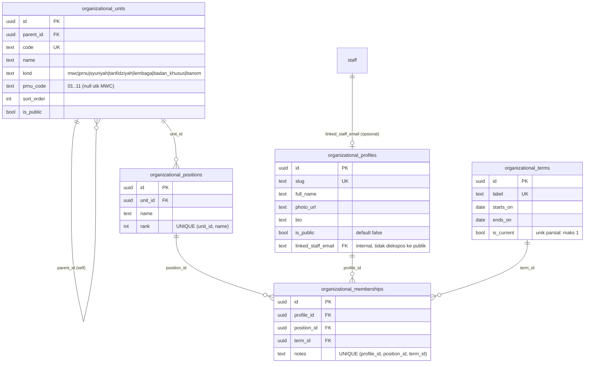

# Proposal Skema Database — Direktori Organisasi MWCNU Pondok Aren (FASE 2–3)

Status: **DRAFT — menunggu persetujuan. Belum dieksekusi.**
Tanggal: 12 November 2026

---

## 1. Prinsip Desain

1. **Pemisahan tegas**: `staff` tetap satu-satunya sumber **identitas & otorisasi** akun pengelola. Direktori publik adalah **data organisasi**, bukan data akun.
2. **Tidak ada data orang fiktif** sebagai data produksi. Seed hanya memuat **unit organisasi** (fakta struktur), bukan orang.
3. **Anggota biasa tidak pernah otomatis masuk direktori.** Tabel direktori terpisah; tautan ke akun bersifat opsional dan eksplisit.
4. **Riwayat** dijaga lewat `organizational_terms` (masa khidmat) — bukan menimpa baris lama.
5. **Multi-jabatan** didukung: satu orang boleh memegang beberapa jabatan pada satu masa khidmat.
6. **RLS aktif di semua tabel baru**; tidak ada policy permisif demi kenyamanan frontend.
7. **Kompatibel dengan skema existing**: tidak mengubah `staff`, `profiles`, `content_items`, `change_log`, maupun storage.
8. Kode PRNU memakai ruang kode yang **sudah ada**: `profile_prnu()` menghasilkan `'01'`–`'11'` (urutan 11 kelurahan), `'00'` = MWC.

---

## 2. Diagram Relasi



Contoh unit yang didukung:

```
mwc (root)
├── syuriyah            → jabatan: Rois, Wakil Rois, Katib, Awan…
├── tanfidziyah         → jabatan: Ketua, Wakil Ketua, Sekretaris, Bendahara…
├── lembaga             → anak: lembaga-<slug> (LP Ma'arif, LDNU, LKKNU, …)
├── badan_khusus        → anak: bk-<slug>
├── banom               → anak: banom-<slug> (Muslimat, Ansor, Fatayat, IPNU, IPPNU, …)
└── prnu-01 … prnu-11   → masing-masing punya Syuriyah & Tanfidziyah sendiri
                           (parent_id = prnu-XX, kind = syuriyah/tanfidziyah)
```

---

## 3. DDL Usulan (belum dieksekusi)

```sql
-- ============ 1) UNIT ORGANISASI ============
create table if not exists public.organizational_units (
  id          uuid primary key default gen_random_uuid(),
  parent_id   uuid references public.organizational_units(id) on delete restrict,
  code        text not null unique,
  name        text not null,
  kind        text not null,
  prnu_code   text,
  sort_order  int  not null default 0,
  is_public   boolean not null default true,
  created_at  timestamptz not null default now(),
  updated_at  timestamptz not null default now(),
  constraint organizational_units_kind_chk check
    (kind in ('mwc','prnu','syuriyah','tanfidziyah','lembaga','badan_khusus','banom')),
  constraint organizational_units_prnu_chk check
    (prnu_code is null or prnu_code ~ '^(0[1-9]|1[01])$'),
  constraint organizational_units_self_chk check (parent_id is null or parent_id <> id),
  constraint organizational_units_prnu_uniq unique (prnu_code),
  constraint organizational_units_name_chk check (length(btrim(name)) between 2 and 120)
);
create index if not exists organizational_units_parent_idx
  on public.organizational_units (parent_id);
create index if not exists organizational_units_kind_idx
  on public.organizational_units (kind, sort_order);

-- ============ 2) MASA KHIDMAT ============
create table if not exists public.organizational_terms (
  id         uuid primary key default gen_random_uuid(),
  label      text not null unique,              -- contoh: '2024–2029'
  starts_on  date not null,
  ends_on    date,
  is_current boolean not null default false,
  created_at timestamptz not null default now(),
  constraint organizational_terms_dates_chk check (ends_on is null or ends_on > starts_on),
  constraint organizational_terms_label_chk check (length(btrim(label)) between 4 and 40)
);
-- maksimal satu masa khidmat aktif
create unique index if not exists organizational_terms_current_uniq
  on public.organizational_terms (is_current) where is_current;

-- ============ 3) PROFIL PUBLIK (identitas direktori, bukan akun) ============
create table if not exists public.organizational_profiles (
  id                 uuid primary key default gen_random_uuid(),
  slug               text not null unique,      -- URL detail: #pengurus/<slug>
  full_name          text not null,
  photo_url          text,
  bio                text,
  is_public          boolean not null default false,  -- default TERTUTUP
  linked_staff_email text references public.staff(email) on delete set null,
  created_at         timestamptz not null default now(),
  updated_at         timestamptz not null default now(),
  constraint organizational_profiles_slug_chk check (slug ~ '^[a-z0-9]+(-[a-z0-9]+)*$'),
  constraint organizational_profiles_name_chk check (length(btrim(full_name)) between 2 and 120),
  constraint organizational_profiles_photo_chk check (photo_url is null or photo_url ~* '^https?://')
);
create unique index if not exists organizational_profiles_staff_uniq
  on public.organizational_profiles (linked_staff_email) where linked_staff_email is not null;

-- ============ 4) JABATAN ============
create table if not exists public.organizational_positions (
  id         uuid primary key default gen_random_uuid(),
  unit_id    uuid not null references public.organizational_units(id) on delete restrict,
  name       text not null,
  rank       int  not null default 0,
  created_at timestamptz not null default now(),
  constraint organizational_positions_uniq unique (unit_id, name),
  constraint organizational_positions_name_chk check (length(btrim(name)) between 2 and 80)
);
create index if not exists organizational_positions_unit_idx
  on public.organizational_positions (unit_id, rank);

-- ============ 5) KEPENGURUSAN (orang × jabatan × masa khidmat) ============
create table if not exists public.organizational_memberships (
  id          uuid primary key default gen_random_uuid(),
  profile_id  uuid not null references public.organizational_profiles(id) on delete cascade,
  position_id uuid not null references public.organizational_positions(id) on delete restrict,
  term_id     uuid not null references public.organizational_terms(id) on delete restrict,
  notes       text,
  created_at  timestamptz not null default now(),
  constraint organizational_memberships_uniq unique (profile_id, position_id, term_id)
);
create index if not exists organizational_memberships_position_idx
  on public.organizational_memberships (position_id, term_id);
create index if not exists organizational_memberships_profile_idx
  on public.organizational_memberships (profile_id);
create index if not exists organizational_memberships_term_idx
  on public.organizational_memberships (term_id);
```

---

## 4. Helper & View (usulan)

```sql
-- prnu milik akun yang login ('' bila bukan pengurus)
create or replace function public.my_prnu()
returns text language sql stable security definer set search_path = public as $$
  select coalesce((select s.prnu from public.staff s
                   where s.email = lower(coalesce(auth.jwt() ->> 'email','')) limit 1), '')
$$;

-- boleh mengelola unit ini?
create or replace function public.manages_unit(p_unit uuid)
returns boolean language sql stable security definer set search_path = public as $$
  select public.is_admin() or exists (
    select 1 from public.organizational_units u
    where u.id = p_unit
      and public.staff_role() = 'pengurus'
      and u.prnu_code is not null
      and u.prnu_code = public.my_prnu()
  )
$$;

-- boleh mengelola jabatan ini?
create or replace function public.manages_position(p_pos uuid)
returns boolean language sql stable security definer set search_path = public as $$
  select exists (select 1 from public.organizational_positions p
                 where p.id = p_pos and public.manages_unit(p.unit_id))
$$;

revoke all on function public.my_prnu(), public.manages_unit(uuid), public.manages_position(uuid)
  from public, anon;
grant execute on function public.my_prnu(), public.manages_unit(uuid), public.manages_position(uuid)
  to authenticated;

-- View baca publik (security_invoker → RLS tabel dasar tetap berlaku)
create or replace view public.directory_public
with (security_invoker = true) as
select m.id,
       t.is_current,
       p.slug, p.full_name, p.photo_url, p.bio,
       u.code as unit_code, u.name as unit_name, u.kind,
       u.prnu_code, u.sort_order as unit_sort,
       pos.name as position_name, pos.rank as position_rank,
       t.label as term_label, t.starts_on, t.ends_on
from public.organizational_memberships m
join public.organizational_profiles p   on p.id  = m.profile_id
join public.organizational_positions pos on pos.id = m.position_id
join public.organizational_units u      on u.id  = pos.unit_id
join public.organizational_terms t      on t.id  = m.term_id
where p.is_public and u.is_public;
```

---

## 5. Strategi RLS

| Tabel | Baca (anon + authenticated) | Tulis (authenticated) |
|---|---|---|
| `organizational_units` | `is_public = true` | `is_admin()` **atau** (`staff_role()='pengurus'` **dan** `prnu_code = my_prnu()`) |
| `organizational_terms` | semua baris | `is_admin()` saja (masa khidmat = keputusan MWC) |
| `organizational_profiles` | `is_public = true` | `is_admin()` saja (identitas publik terpusat) |
| `organizational_positions` | unit-nya publik | `manages_unit(unit_id)` |
| `organizational_memberships` | profil publik **dan** unit publik | `manages_position(position_id)` |

Grants:

```sql
revoke all on public.organizational_units, public.organizational_terms,
              public.organizational_profiles, public.organizational_positions,
              public.organizational_memberships
  from anon, authenticated;

-- Baca: kolom publik saja (linked_staff_email TIDAK pernah diekspos)
grant select (id, parent_id, code, name, kind, prnu_code, sort_order, is_public)
  on public.organizational_units to anon, authenticated;
grant select on public.organizational_terms to anon, authenticated;
grant select (id, slug, full_name, photo_url, bio, is_public)
  on public.organizational_profiles to anon, authenticated;
grant select on public.organizational_positions to anon, authenticated;
grant select on public.organizational_memberships to anon, authenticated;
grant select on public.directory_public to anon, authenticated;

-- Tulis: hanya peran yang lolos RLS di atas
grant insert, update, delete on public.organizational_units,
      public.organizational_terms, public.organizational_profiles,
      public.organizational_positions, public.organizational_memberships
  to authenticated;
```

Catatan keamanan:
- `linked_staff_email` **tidak** masuk grant SELECT → email internal tidak bocor ke publik maupun anggota login.
- Tidak ada policy DELETE untuk anon. Penghapusan unit/jabatan dibatasi `restrict` FK agar riwayat tidak hilang diam-diam.
- Audit: trigger `log_change()` existing dapat dipasang ke kelima tabel (opsional, disarankan).

---

## 6. Pemeriksaan Kesesuaian dengan Database Existing

| Aspek | Temuan | Keputusan |
|---|---|---|
| `staff` (email PK, role, nama, prnu) | Sumber identitas & otorisasi | **Tidak diubah**; hanya direferensikan opsional oleh `organizational_profiles.linked_staff_email` |
| `profiles` (anggota + NIA) | Berisi PII, RLS ketat | **Tidak diubah, tidak direferensikan** → mustahil anggota bocor otomatis ke direktori |
| Ruang kode PRNU | `profile_prnu()`: `'00'`=MWC, `'01'`–`'11'`=11 kelurahan berurutan | `organizational_units.prnu_code` memakai rentang yang sama |
| `content_items` / CMS | Konten berita, agenda, dll | Tidak bersinggungan; direktori memakai tabel relasional sendiri (bukan CMS) |
| `change_log` | Audit generik per tabel | Dapat dipasang ke tabel baru tanpa mengubah struktur |
| Storage `media` | Foto pengurus memakai bucket yang sama | `photo_url` menyimpan URL publik hasil upload admin (policy P0-2 sudah memperketat path) |

Tidak ada duplikasi: tidak ada tabel kedua untuk "orang" di luar `staff` (akun) dan `profiles` (anggota), karena keduanya punya makna berbeda dan direktori memerlukan entitas orang publik yang bisa **tidak** punya akun.

---

## 7. Seed Data (fakta struktur, tanpa orang)

Hanya unit struktural — **tidak ada nama orang**:

```sql
insert into public.organizational_units (code, name, kind, prnu_code, sort_order)
values
  ('mwc','MWCNU Pondok Aren','mwc',null,0),
  ('syuriyah','Syuriyah MWCNU Pondok Aren','syuriyah',null,1),
  ('tanfidziyah','Tanfidziyah MWCNU Pondok Aren','tanfidziyah',null,2),
  ('prnu-01','PRNU Pondok Aren','prnu','01',10),
  ('prnu-02','PRNU Jurangmangu Barat','prnu','02',11),
  ('prnu-03','PRNU Jurangmangu Timur','prnu','03',12),
  ('prnu-04','PRNU Pondok Betung','prnu','04',13),
  ('prnu-05','PRNU Pondok Karya','prnu','05',14),
  ('prnu-06','PRNU Pondok Jaya','prnu','06',15),
  ('prnu-07','PRNU Pondok Pucung','prnu','07',16),
  ('prnu-08','PRNU Pondok Kacang Barat','prnu','08',17),
  ('prnu-09','PRNU Pondok Kacang Timur','prnu','09',18),
  ('prnu-10','PRNU Parigi Baru','prnu','10',19),
  ('prnu-11','PRNU Parigi Lama','prnu','11',20)
on conflict (code) do nothing;
```

Unit `lembaga`, `badan_khusus`, `banom` **tidak di-seed** karena daftar resminya perlu konfirmasi pengurus (akan diisi via admin, bukan ditebak).

Masa khidmat awal: dibuat oleh pengurus (label + tanggal) — tidak ditebak.

---

## 8. Strategi Migrasi & Rollback

1. Semua DDL **idempotent** (`if not exists`, `create or replace`), dijalankan di SQL Editor setelah persetujuan.
2. Tidak ada `alter`/`drop` pada tabel existing → risiko regresi nol.
3. Rollback = `drop view`/`drop table` kelima tabel baru (tidak menyentuh data existing).
4. Urutan: tabel → helper → view → grants/RLS → seed unit → uji RLS → baru frontend FASE 2.

Uji RLS wajib setelah migrasi (FASE 6 nanti diulang menyeluruh):
- anon: hanya baris `is_public`; `linked_staff_email` tidak terbaca (kolom tidak di-grant).
- pengurus prnu-08: bisa tulis unit `prnu-08`, **ditolak** untuk `prnu-03`.
- anggota login biasa: baca publik saja, tulis ditolak.
- admin: semua unit.

---

## 9. Rencana Frontend (setelah skema disetujui)

| Section | Isi | Data |
|---|---|---|
| `#direktori-pengurus` | Daftar pengurus MWC (Syuriyah + Tanfidziyah + Lembaga + Badan Khusus + Banom), pencarian nama, filter jabatan/lembaga/banom | `directory_public` (term aktif) |
| `#struktur-organisasi` | Pohon struktur per unit + masa khidmat | `organizational_units` + `directory_public` |
| `#direktori-ranting` | 11 PRNU + pengurusnya | `organizational_units` (kind=prnu) + `directory_public` |
| Detail pengurus | `#pengurus/<slug>` — foto, nama, jabatan, unit, masa khidmat, riwayat (semua term) | `directory_public` by slug |

Pola tetap SPA existing: section hidden + `VW`/`VWnoback` + `route()`, tanpa framework baru. Pencarian/filter dilakukan di klien (data direktori kecil), dengan query Supabase ber-RLS.

---

## 10. Keputusan yang Diminta

1. **Setujui 5 tabel + 3 helper + 1 view** di atas → saya siapkan file migrasi `supabase/direktori-organisasi.sql` untuk Anda jalankan.
2. **Seed hanya unit struktural** (MWC, Syuriyah, Tanfidziyah, 11 PRNU) — tanpa orang, tanpa menebak lembaga/banom.
3. **Hak tulis**: `super_admin` semua; `pengurus` hanya unit dengan `prnu_code` miliknya; `organizational_profiles` hanya `super_admin`.
4. **Urutan**: FASE 2 (pengurus MWC + struktur) → FASE 3 (11 PRNU + pencarian/filter + detail).

Setelah persetujuan, migrasi tetap **tidak dijalankan otomatis** — Anda yang mengeksekusi di SQL Editor.
