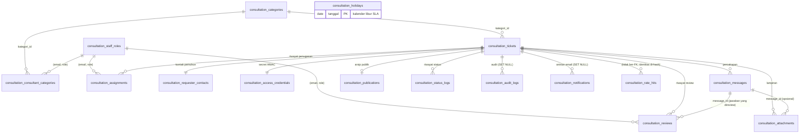
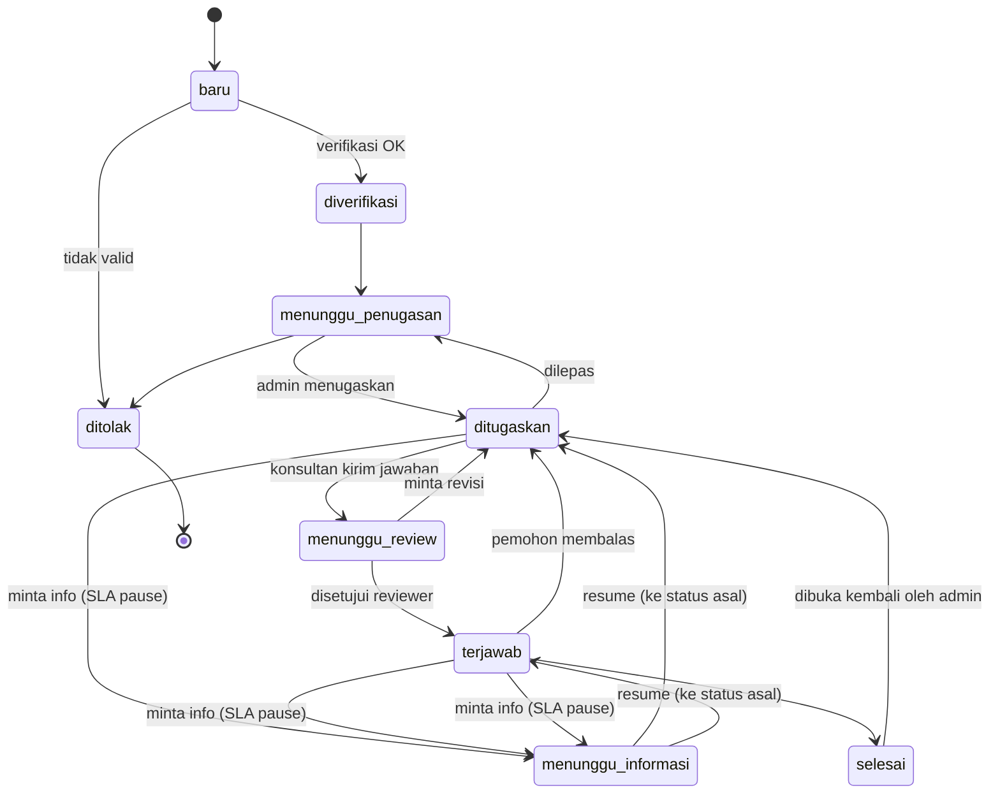

# ERD — Modul Konsultasi Agama (Phase 1)

> Seluruh objek berprefix `consultation_`. Tabel existing (`staff`, `profiles`,
> `content_items`, dst.) **tidak disentuh** dan tidak ada FK masuk/keluar ke tabel
> modul ini — integrasi dilakukan lewat email di `consultation_staff_roles`
> (harus cocok dengan `auth.users.email`), bukan lewat foreign key.
> Zona waktu resmi: WIB (`Asia/Jakarta`).

## Diagram Relasi

## Batas Integrasi dengan Sistem Existing

| Titik temu | Mekanisme | Catatan |
|---|---|---|
| Identitas pemohon | `consultation_requester_contacts` (WA/email) | Tidak memakai `auth.users`; pemohon = pengguna publik |
| Identitas staf | `consultation_staff_roles.email` | Harus cocok dengan email Google pada `auth.users`; divalidasi Edge Function |
| Role | `role_konsultasi` (admin_konsultasi/konsultan/reviewer) | **Terpisah penuh** dari `staff.role` CMS |
| Bucket lampiran | `consultation-attachments` (privat) | Terpisah dari bucket `media` publik |
| Penyimpanan secret | `consultation_access_credentials.secret_hash` | HMAC-SHA256, pepper di secrets Edge Functions |

## Kelompok Tabel

1. **Referensi** — `consultation_categories`, `consultation_holidays`,
   `consultation_staff_roles`, `consultation_consultant_categories`.
2. **Transaksi** — `consultation_tickets`, `consultation_requester_contacts`,
   `consultation_access_credentials`, `consultation_messages`,
   `consultation_assignments`, `consultation_reviews`, `consultation_attachments`.
3. **Operasional** — `consultation_publications`, `consultation_status_logs`,
   `consultation_audit_logs`, `consultation_notifications`, `consultation_rate_hits`.

## Mesin Status Tiket

Aturan penegakan:
- Transisi divalidasi `consultation_can_transition()` + trigger tiket (002_tables).
- Keluar dari `menunggu_informasi` **hanya** ke `status_sebelum_pause`;
  tenggat SLA digeser sejumlah hari kerja yang tertutup penuh jeda
  (definisi matematis: `MIGRATION_GUIDE.md` §2b).
- SLA mulai dihitung saat status pertama kali `diverifikasi` /
  `menunggu_penugasan` (target 3 hari kerja, kalender libur memengaruhi).
- Nomor tiket di-generate trigger dari sequence
  `consultation_nomor_tiket_seq` — unik dijamin sequence, aman terhadap
  transaksi bersamaan; format `KON-YYMMDD-<kode base-32>`.

Detail kolom per tabel: lihat `DATABASE_DICTIONARY.md`.
